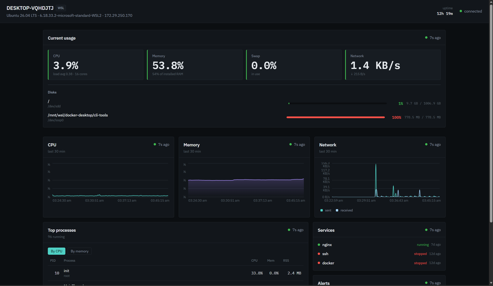
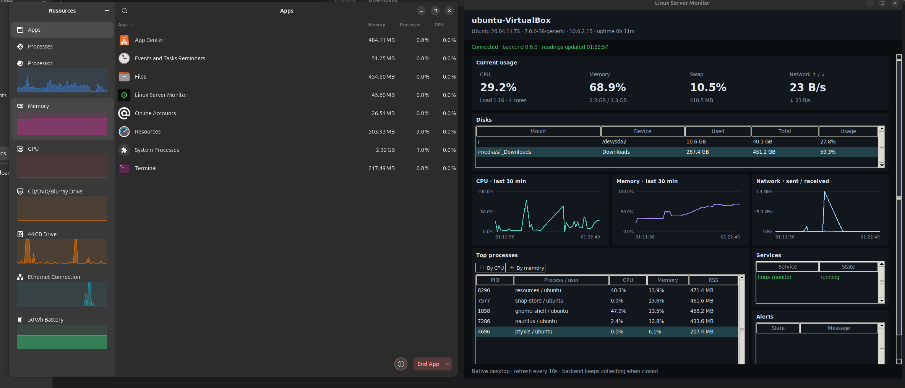
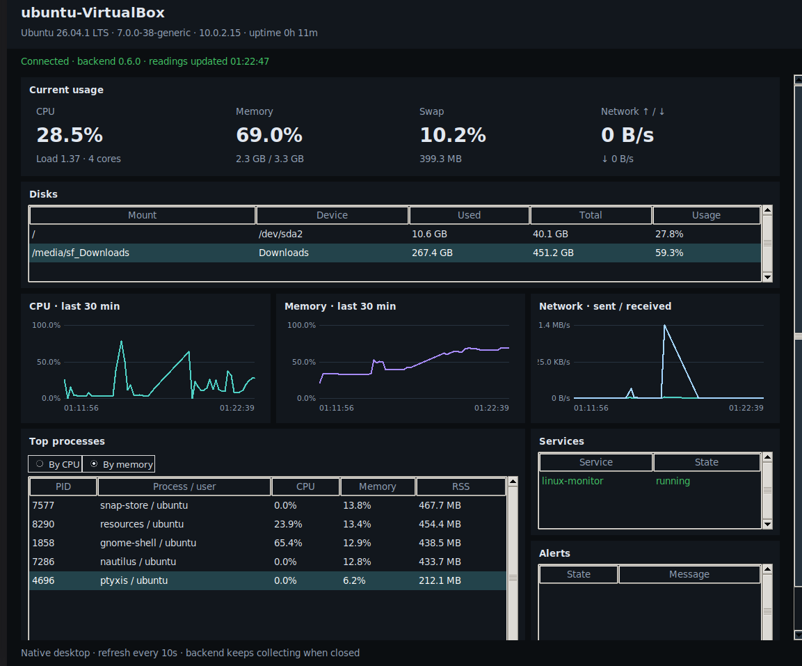
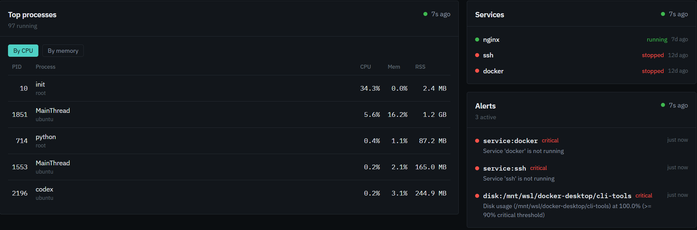
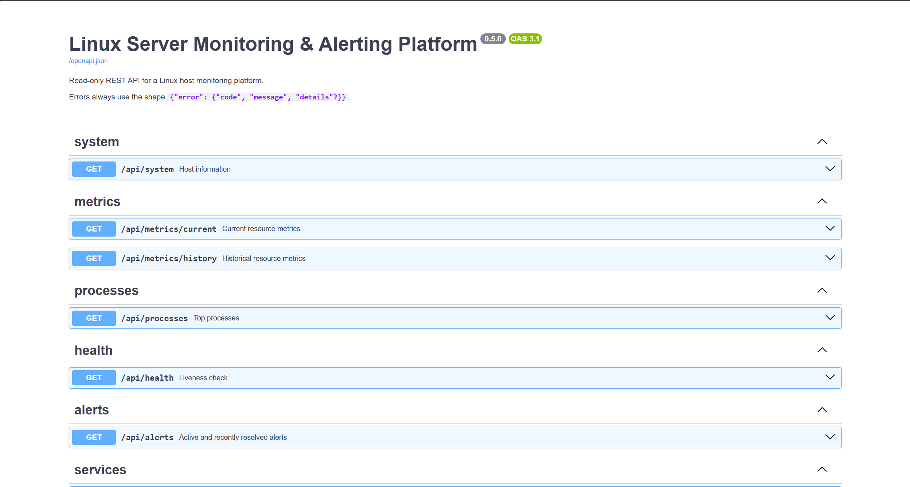
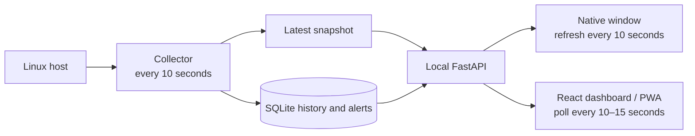

# Linux Server Monitor

Linux Server Monitor **0.6.0** is a lightweight, read-only dashboard for one Linux host. A small Python service samples host metrics, stores short-term history in SQLite, checks selected systemd services, evaluates threshold alerts, and serves a local API. Choose a native Ubuntu desktop window, a browser dashboard/PWA, Docker, or the API on its own.

## Screenshots

### Dashboard



### Resource Usage Comparison



### Native Desktop Window



### Alerts



### API Documentation



## Download

Download the Ubuntu package from the [latest stable release page](https://github.com/A-akarshanSharma/linux-monitor/releases/latest). Check that page for v0.6.0 availability; no release status is assumed here. The documented package targets are Ubuntu 24.04 amd64 and Ubuntu 26.04 amd64; use the package built for your Ubuntu release. See the release notes and [installation guide](packaging/README.md) for setup, compatibility, and verification details.

After downloading the matching v0.6.0 asset, install it from its download folder:

```bash
# Ubuntu 24.04 amd64
sudo apt install ./linux-monitor_0.6.0-1+ubuntu24.04_amd64.deb

# Ubuntu 26.04 amd64
sudo apt install ./linux-monitor_0.6.0-1+ubuntu26.04_amd64.deb
```

The packaged native window is designed to avoid the extra memory cost of running a browser just to view metrics. In the Ubuntu 26.04 VirtualBox screenshots shared with this project, the monitor process used **45.6 MB** and showed **0.0–0.2% CPU** in Ubuntu Resources. A separate local native-window measurement recorded **40.6 MiB RSS** and **0.1% of one CPU core** during a 60-second idle observation. These are observations, not guarantees: VM graphics, desktop services, host load, screen size, and sampling activity change the result. The GUI number excludes the background monitoring service.

## What it does

- Samples CPU, memory, swap, disk usage, network rates, and top processes.
- Records readings in a local SQLite database and shows a rolling 30-minute chart.
- Checks configured systemd services and creates alerts for sustained CPU, memory, disk, or monitored-service issues.
- Serves a documented, read-only REST API and an interactive API page at `/docs`.
- Provides a native Python/Tk window, a React dashboard that can be installed as a PWA, and Ubuntu `.deb` packages.
- Keeps collection running when the desktop window is closed, as long as its service and Linux system are running.

## Resource comparison

In the point-in-time Ubuntu Resources view, the monitor's own row showed about 45.6 MB and 0.0–0.2% CPU. Ubuntu Resources reports its own process separately and can itself use substantially more memory. This is a useful real-system example, but not a controlled benchmark: the VM's totals include Ubuntu, Firefox, the display server, and other programs. The dashboard's CPU card reports the **monitored host's CPU**, not CPU used by the monitor application. Compare the monitor process row in Ubuntu Resources to assess the app itself.

| Comparison | What is being measured | Observed result | How to interpret it |
| --- | --- | ---: | --- |
| Native window in the shared Ubuntu VM | Monitor's `python3` process | 45.6 MB; 0.0–0.2% CPU | Your screenshot; point-in-time process reading. |
| Native window, local 60-second check | GUI process RSS and CPU | 40.6 MiB RSS; 0.1% of one core | Controlled local idle observation, not the backend or the whole VM. |
| Background API service, separate local check | Backend process RSS and CPU | 85.2 MiB RSS; 0.7% of one core | Measured separately; do not add this to the GUI result as if both were benchmarked together. |
| Browser dashboard, local production-browser check | Browser process tree, including browser runtime | Chrome 390.4 MiB PSS / 2.5% CPU; Firefox 417.1 MiB PSS / 3.5% CPU | A separate 60-second browser test; see [browser measurement details](frontend/README.md#local-measurements-051-2026-10-07). |

The browser figures include a browser runtime and use **PSS** (shared pages counted proportionally); the native figure uses **RSS** for one process. These methods are not directly interchangeable. Browser dashboards still make sense when a richer UI, a remote browser, or a PWA matters more than minimizing desktop overhead. The native window avoids launching that browser, but has a simpler desktop UI and still depends on the backend service for readings.

## How it works



## Collection and refresh timing

The default collection interval is **10 seconds** (`MONITOR_POLLING_INTERVAL_SECONDS`). The backend takes an initial reading at startup, then wakes its collector every 10 seconds. Each successful sample updates the live snapshot, writes history, checks configured services, and evaluates alerts. The native window requests the dashboard data every **10 seconds**. The browser dashboard polls current metrics, processes, and alerts every **10 seconds**, and the mostly static system, history, and service endpoints every **15 seconds**. Its “updated” age label ticks once a second; that label is not another metrics collection.

This interval keeps idle work low because the collector sleeps between samples. CPU is not guaranteed to remain at zero: sampling process and disk data costs work, busy hosts add load, and a collection can show a brief CPU or I/O pulse. A 10-second interval also means a new reading or alert can take roughly one interval to appear; shorter intervals improve freshness but increase sampling, database, and API work. Browser requests pause while its page is hidden; backend collection continues while either UI is closed. The 30-minute graphs therefore contain roughly 180 samples at the default interval. History is retained for 7 days by default.

## Install the Ubuntu desktop app

Install the `.deb` built for your Ubuntu release and CPU architecture. Current package targets are Ubuntu **24.04 amd64** and Ubuntu **26.04 amd64**. Do not rename a package built for one Ubuntu/Python version to imply compatibility with another.

```bash
sudo apt install ./linux-monitor_<version>_<architecture>.deb
```

Launch **Linux Server Monitor** from the applications menu or run:

```bash
linux-monitor
```

APT installs the required system packages, including Python/Tk. The application package contains the backend, Python production dependencies, built web dashboard, native launcher, and systemd service; an end user does not need Node, npm, pip, Docker, or a source checkout. The service runs as a dedicated `linux-monitor` user, listens on localhost port **8765**, and stores its database at `/var/lib/linux-monitor/monitor.db`.

Useful commands:

```bash
systemctl status linux-monitor
linux-monitor --native
linux-monitor --browser
linux-monitor --url
```

The native window uses the backend service and refreshes every 10 seconds. Closing it leaves collection running. `--browser` opens the bundled dashboard in a browser; the dashboard can be installed as a PWA through a supported browser. On WSL, the native window needs WSLg/X11 (`DISPLAY`); without a Linux display the launcher opens the Windows browser. WSL must remain running for live data, and the readings describe WSL/Linux, not the Windows host.

See [package documentation](packaging/README.md) for updating, removal, configuration, WSL shortcuts, package builds, and verification. Package history is deliberately retained when the package is removed; `apt purge` also retains it. Remove the database separately only if you intend to erase saved history.

## Quick start with Docker

```bash
cp .env.example .env   # optional: adjust collection and alert settings
docker compose up --build
```

Open the dashboard at <http://localhost:8080> and the API docs at <http://localhost:8000/docs>. The default Compose setup reports **container-scoped** metrics and service status is `UNKNOWN` because the containers do not run systemd. This is convenient for trying the app, but it is not a full host monitor.

Compose binds both published ports to host loopback; other machines cannot reach them by default. Inside Compose, the backend explicitly listens on the container interface so the frontend proxy can reach it even when the copied `.env` sets the host-only bind used for a direct host run.

On native Linux, `docker-compose.host.yml` can expose host `/proc` data for closer host CPU, memory, and process readings:

```bash
docker compose -f docker-compose.yml -f docker-compose.host.yml up --build
```

The overlay still does not provide host disk/network views or systemd service monitoring. For the most accurate host monitoring, run the service directly on the host or install the `.deb`. On macOS, Windows Docker Desktop, and WSL-hosted Docker, Linux bind mounts do not turn the container into a full view of the physical host. `docker compose down -v` deletes the stored database volume.

## Run from source

Requirements: Linux, Python **3.10+**, and Node.js **22.12+** for the web dashboard. Keep the checkout in the Linux filesystem when using WSL (for example, under `~/projects` rather than `/mnt/c`).

Start the backend in one terminal:

```bash
cd backend
python3 -m venv .venv
source .venv/bin/activate
pip install -r requirements-dev.txt
python -m app
```

Start the dashboard in another terminal:

```bash
cd frontend
npm ci
npm run dev
```

Open <http://localhost:5173>. The development server proxies `/api` calls to the backend at `127.0.0.1:8000`. The backend's interactive API documentation is at <http://localhost:8000/docs>. For a quick collector-only snapshot, run `python -m app.collectors` from `backend/`; add `--watch` to sample repeatedly at the configured interval.

### Run the API on the host with systemd

The host scripts are useful for development and systems where a `.deb` is not available:

```bash
scripts/run_host.sh
# In another terminal, install and start the service:
scripts/install_systemd_unit.sh
sudo systemctl enable --now linux-monitor-backend
```

The systemd installer expects `scripts/run_host.sh` to have initialized the backend virtual environment first. For the packaged desktop build, prefer the package's separate `linux-monitor` service and launcher.

## API reference

All endpoints are read-only. Data describes the Linux environment visible to the backend process.

| Method | Endpoint | Purpose |
| --- | --- | --- |
| GET | `/api/health` | Liveness, version, and API uptime. |
| GET | `/api/system` | Hostname, OS, kernel, address, uptime, and detected runtime environment. |
| GET | `/api/metrics/current` | Latest CPU, memory, swap, disk, and network snapshot. |
| GET | `/api/metrics/history?minutes=30` | Stored metric samples, oldest first; default window is 60 minutes. |
| GET | `/api/processes?limit=8` | Process count and top processes by CPU and memory; limit is 1–50, API default is 5. |
| GET | `/api/services` | Current configured service states: `RUNNING`, `STOPPED`, or `UNKNOWN`. |
| GET | `/api/alerts?minutes=1440` | All active alerts and recently resolved alerts. |
| GET | `/docs` | Interactive Swagger UI; `/openapi.json` is the schema. |

Errors use a consistent JSON envelope, including validation errors:

```json
{"error":{"code":"validation_error","message":"Request validation failed.","details":[{"field":"query.limit","message":"Input should be less than or equal to 50"}]}}
```

`/api/health` is a liveness endpoint; it does not promise that every collector or host integration is healthy. Check the returned readings and service states as well.

## Configuration

Configuration precedence is: explicit settings, `MONITOR_*` environment variables, `.env`, `backend/config/monitor.yaml`, then defaults. Copy `.env.example` to `.env` to customize a local checkout; `.env` is ignored by Git. The package instead reads `/etc/linux-monitor/monitor.env`.

| Setting | Default | Effect |
| --- | ---: | --- |
| `MONITOR_POLLING_INTERVAL_SECONDS` | `10` | Background collection and native UI refresh period, in seconds. |
| `MONITOR_RETENTION_DAYS` | `7` | Metric history retention. |
| `MONITOR_DATABASE_PATH` | `data/monitor.db` | SQLite path, relative to `backend/` unless absolute. |
| `MONITOR_MONITORED_SERVICES` | `nginx,ssh,docker` | Comma-separated systemd units to check. The package defaults to its own `linux-monitor` service. |
| `MONITOR_CPU_WARNING_PERCENT` / `MONITOR_CPU_CRITICAL_PERCENT` | `85` / `95` | CPU thresholds; warning must persist for 60 seconds by default. |
| `MONITOR_MEMORY_WARNING_PERCENT` / `MONITOR_MEMORY_CRITICAL_PERCENT` | `90` / `95` | Memory thresholds, evaluated at each sample. |
| `MONITOR_DISK_WARNING_PERCENT` / `MONITOR_DISK_CRITICAL_PERCENT` | `80` / `90` | Per-filesystem thresholds. |
| `MONITOR_BACKEND_HOST` / `MONITOR_BACKEND_PORT` | `127.0.0.1` / `8000` | Development API bind address and port. |

All settings, including log format, process count, history lookback, and excluded filesystem types, are documented in [.env.example](.env.example) and [backend/config/monitor.yaml](backend/config/monitor.yaml). The native package and source backend bind to localhost by default, and Compose binds its published ports to host loopback. The API has no user authentication or TLS of its own; if you deliberately change those bindings for remote access, put it behind an appropriately secured HTTPS reverse proxy and firewall.

## Resource-use tradeoffs and limitations

The low idle CPU and modest native-window memory use come from the small Tk UI, no browser runtime in native mode, and sleeping between 10-second collection cycles. They do not mean the whole installation has zero cost: the always-on backend is a separate process (about 85 MiB RSS in one local measurement), stores samples, and wakes periodically. The VM's desktop, browser, and virtual graphics stack also affect total memory and CPU.

| Choice | Benefit | Cost / limitation |
| --- | --- | --- |
| 10-second sampling | Low idle work and a compact history database. | Readings and alerts can lag by nearly 10 seconds; faster polling spends more CPU and writes more often. |
| Native desktop window | Avoids the browser runtime; the shared VM screenshot shows about 45.6 MB for its process. | Requires a graphical Linux session and Python/Tk; the web dashboard is visually richer. The backend still runs separately. |
| Browser/PWA dashboard | Richer interface and installable browser window; no special Linux GUI toolkit. | Browser and graphics processes add memory; PWA shell caching does not cache metric data or work without the backend. |
| Docker | Simple, repeatable setup. | Default readings describe the container. Host overlay only improves some Linux metrics; service checks remain unavailable. |
| systemd service checks | Useful for host services on a normal Linux installation. | Requires systemd visibility/permissions. Containers and some WSL setups report `UNKNOWN`; the service account may not read every process detail. |
| Local-only API | Safe default for a single-machine dashboard. | No built-in login, multi-user access control, or TLS; do not expose it directly to a network. |
| SQLite | Simple, durable single-host history with no database server. | Designed for one local monitor, not a replicated or high-write fleet database. |

Other scope limits: the project is Linux-focused; Windows support means monitoring Linux inside WSL, not Windows itself. Alerts currently cover CPU, memory, disk, and configured service state rather than arbitrary custom rules or notifications to email/chat. Package builds are amd64 Ubuntu releases; other architectures need their own build and verification. The GitHub Actions workflow checks the backend on Python 3.12 and 3.14 and checks the frontend; package installation and the native GUI still need their separate target-specific checks. Sensible next improvements are automating those package checks, ARM builds, optional secured remote access, more alert integrations, and a polished native view.

## Development and verification

Backend tests and lint:

```bash
cd backend
source .venv/bin/activate
pytest
ruff check app tests ../packaging ../scripts
ruff format --check app tests ../packaging ../scripts
```

Frontend tests and lint:

```bash
cd frontend
npm ci
npm test
npm run lint
```

The native desktop integration check needs `python3-tk`, Xvfb, and `xauth` on a headless Linux machine:

```bash
xvfb-run -a python3 scripts/check_native_desktop.py
```

Packaging verification and repeatable Ubuntu builds are documented in [packaging/README.md](packaging/README.md). The [GitHub Actions workflow](.github/workflows/ci.yml) runs the backend test/lint/format checks and frontend tests/lint/build on pushes and pull requests. It does not install `.deb` packages or launch a native desktop window. Generated `.deb` files, local databases, virtual environments, Node dependencies, caches, and local `.env` files are intentionally excluded from Git.

## Repository layout

```text
backend/       FastAPI API, Linux collectors, scheduler, alerts, SQLite storage
frontend/      React/Vite dashboard, PWA shell, browser-specific documentation
packaging/     Native Tk window, Debian metadata, package checks
scripts/       Host-service, frontend deployment, and .deb build/check helpers
docker-compose.yml
docker-compose.host.yml
```

## License

This project is licensed under the MIT License. See [LICENSE](LICENSE) for the full license text.
